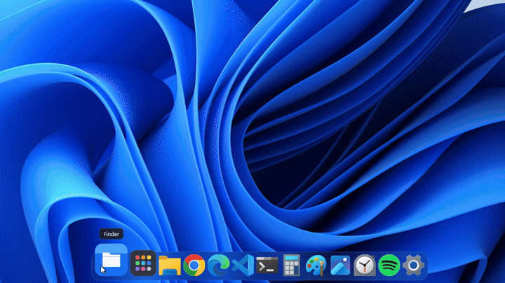

# Cais

**A dock, menu bar, Stage, Overview and file manager for Windows, with a macOS-inspired look.**
Light, open source and **100% local**: Cais has no network code at all.

[Português](README.md) · [Contributing](CONTRIBUTING.md) · [MIT License](LICENSE)



> *Cais* is Portuguese for "quay": where boats dock. Here, it's where your apps dock.

- A single ~1 MB `cais.exe`, written in Rust. No Electron, no .NET, no embedded browser.
- Idle, it uses **0.01% CPU** and about **9 MB of working memory**.
- Starts in under **300 ms**.
- UI in **English and Portuguese** (follows the Windows language).

---

## What's inside

### Dock
- Pinned and running apps, with magnification, bounce on launch and running indicators.
- At the **bottom, left or right** of the screen.
- **Window previews**: rest the mouse on an app to see its open windows and pick one.
- **Stacks**: folders in the dock (Downloads by default) fan out their most recent files.
- **Trash** at the end of the dock, full or empty, with "Empty Trash".
- **Recents** on right-click: the last files opened with that app.
- Apps installed from Chrome or Edge (PWAs) and Store apps each get their own icon.
- Drag to reorder, auto-hide and keyboard navigation (**Ctrl+F3**).
- Hides the Windows taskbar while running and gives it back on quit.

### Menu bar
- The focused app's name and menus, including modern apps (via UI Automation).
- System menu (sleep, restart, shut down, lock) and a **Window** menu.
- System tray icons, a clock with a calendar and **virtual desktop** dots (click to switch).
- One bar per display.

### Overview, app switcher and hot corners
- **Overview** (Win+Ctrl+Up): every window side by side, live. Click one to bring it forward.
- **App switcher** on Alt+Tab showing the icons of open apps (optional).
- **Hot corners**: push the mouse into a corner to open Overview, show the desktop, open Apps, search or lock the screen.

### Stage (minimized windows)
- Minimized windows become 3D cards on the side of the display they were on.
- **Genie** effect when minimizing and restoring, drawn by the Windows compositor itself.

### Files
- Icon, list and **column** views (Ctrl+1, Ctrl+2, Ctrl+3) with tabs (Ctrl+T).
- Favorites, "This PC", Trash, Space to preview, F2 to rename and search in subfolders.
- Drag and drop, the Windows context menu and `.zip` extraction on double-click.
- Folders opened in Windows open in Files (optional; hold **Shift** to use File Explorer).

### Search and Apps
- **Alt+Space**: apps, settings, **files by name and content** (the Windows index) and a calculator.
- **Apps**: every installed app, full screen.

### Appearance and accessibility
- Light, dark or automatic theme, accent color and glass transparency.
- **Reduce motion** (follows Windows "Animation effects") and **high contrast** support.
- Optional start-as-administrator at login, to work with elevated apps.

---

## Privacy, with proof

Cais makes no connections. No auto-update, no account, no telemetry, no data collection. You can check it, and [CI](.github/workflows/ci.yml) checks it on every change:

| Guarantee | How to check |
|---|---|
| No networking, TLS or telemetry library in the project | `cargo deny check` (rules in [`deny.toml`](deny.toml)) |
| The executable imports no networking DLL | `.\scripts\verificar-privacidade.ps1` |
| Everything it writes stays on your PC, in plain text | see [Where the data lives](#where-the-data-lives) |

The Control Center **reads** the network status through Windows, and file search uses the local Windows Search index; neither sends anything.

For extra peace of mind, block `cais.exe` in Windows Firewall. It keeps working the same.

---

## Install

Download the `.zip` from [Releases](../../releases), extract it and run:

```
cais.exe --install
```

It copies Cais to `%LOCALAPPDATA%\Programs\Cais`, adds a Start menu shortcut and registers it under "Installed apps". No administrator rights needed.

To uninstall: **Settings > About > Uninstall**, or Windows "Installed apps".

> Until the executable is digitally signed, Windows SmartScreen and some antivirus tools may distrust it for being new. See [docs/ASSINATURA.md](docs/ASSINATURA.md).

## Build

You need [Rust](https://rustup.rs) and Visual Studio Build Tools (C++ and the Windows SDK).

```
cargo build --release
cargo test --release
.\target\release\cais.exe
```

Requires Windows 11.

---

## Shortcuts

| Action | Shortcut |
|---|---|
| Search | Alt+Space |
| Overview | Win+Ctrl+Up |
| App switcher (if on) | Alt+Tab |
| Keyboard focus on the dock | Ctrl+F3, then arrows, Enter and Esc |
| Files views | Ctrl+1, Ctrl+2, Ctrl+3 |
| Open a folder in File Explorer | hold Shift while opening |
| Show layout areas | hold Shift while dragging a window |

### Command line

| Option | What it does |
|---|---|
| `--install` / `--uninstall` | installs or removes Cais for the current user |
| `--restore-taskbar` | gives the Windows taskbar back (if Cais was killed) |
| `--medir N --saida file.txt` | measures CPU, memory and startup time for N seconds |
| `--estresse` | with `--medir`, animates nonstop to measure the worst case |

---

## Where the data lives

| File | What it keeps |
|---|---|
| `%APPDATA%\Cais\config.txt` | settings |
| `%APPDATA%\Cais\fixados.txt` | items pinned to the dock, one per line |
| `%APPDATA%\Cais\historico.txt` | apps opened from search (to rank results) |
| `%LOCALAPPDATA%\Cais\icones\` | icon cache |
| `%LOCALAPPDATA%\Cais\barra-original.txt` | taskbar state, to restore on quit |

Deleting the `Cais` folder resets everything.

---

## Known limits

- Cais can't read other apps' notifications (Windows only allows that for Store apps). The calendar opens the Windows panel.
- Corners and transparency of **other** programs' windows don't change: that would require injecting code into them.
- Electron app menus in the bar are experimental and off by default: reading them turns on the app's accessibility mode.
- Moving a window to another display with the keyboard only (Win+Shift+arrow) and minimizing right after may send its card to the old display.

## License

[MIT](LICENSE). Cais uses no Apple trademarks, icons, fonts or images; every icon is drawn in code. macOS, Finder, Launchpad and Mission Control are trademarks of Apple Inc., mentioned only as style references.
