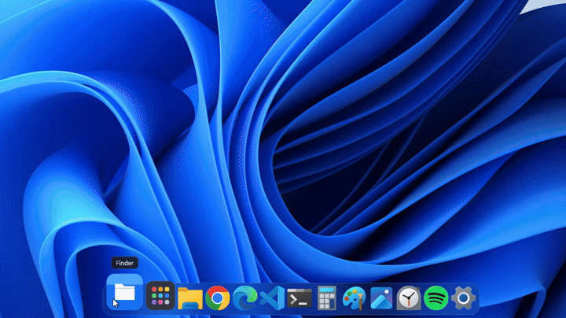

# Cais

**Dock, barra de menu, Palco, Visão Geral e gerenciador de arquivos para Windows, com visual inspirado no macOS.**
Leve, open source e **100% local**: o Cais não tem nenhum código de rede.

[English](README.en.md) · [Como contribuir](CONTRIBUTING.md) · [Licença MIT](LICENSE)



> *Cais* é o lugar onde os barcos atracam. Aqui, é onde os seus apps atracam.

- Um único `cais.exe` de ~1 MB, escrito em Rust, sem Electron, .NET ou navegador embutido.
- Parado, usa **0,01% de CPU** e cerca de **9 MB de memória em uso**.
- Abre em menos de **300 ms**.
- Interface em **português e inglês** (segue o idioma do Windows).

---

## O que vem nele

### Dock
- Apps fixados e abertos, com ampliação ao passar o mouse, pulo ao abrir e indicador de janela aberta.
- **Embaixo, na esquerda ou na direita** da tela.
- **Prévia das janelas**: pare o mouse num app para ver as janelas abertas dele e escolher uma.
- **Pilhas**: pastas no dock (Downloads vem por padrão) abrem um leque com os arquivos mais recentes.
- **Lixeira** no fim do dock, cheia ou vazia, com "Esvaziar Lixeira".
- **Recentes** no clique direito: os últimos arquivos abertos com aquele app.
- Apps instalados pelo Chrome ou Edge (PWAs) e apps da Loja aparecem cada um no seu ícone.
- Arraste para reordenar, ocultar automaticamente e navegação pelo teclado (**Ctrl+F3**).
- Esconde a barra de tarefas do Windows enquanto roda e devolve ao sair.

### Barra de menu
- Nome do app em foco e os menus dele, inclusive de apps modernos (pela UI Automation).
- Menu do sistema (suspender, reiniciar, desligar, bloquear) e menu **Janela**.
- Ícones da bandeja do sistema, relógio com calendário e pontinhos das **áreas de trabalho virtuais** (clique para trocar).
- Uma barra em cada monitor.

### Visão Geral, alternador e cantos ativos
- **Visão Geral** (Win+Ctrl+↑): todas as janelas lado a lado, ao vivo. Clique numa para trazê-la.
- **Alternador de apps** no Alt+Tab, com os ícones dos apps abertos (opcional).
- **Cantos ativos**: encoste o mouse num canto para abrir a Visão Geral, mostrar a área de trabalho, abrir os Apps, a busca ou bloquear a tela.

### Palco (janelas minimizadas)
- Janelas minimizadas viram cartões em 3D na lateral do monitor onde estavam.
- Efeito **gênio** ao minimizar e ao restaurar, desenhado pelo próprio compositor do Windows.

### Arquivos
- Ícones, lista e **colunas** (Ctrl+1, Ctrl+2, Ctrl+3), com abas (Ctrl+T).
- Favoritos, "Este Computador", Lixeira, prévia com Espaço, renomear com F2 e busca em subpastas.
- Arrastar e soltar, menu de contexto do Windows e `.zip` extraído com clique duplo.
- Pastas abertas no Windows abrem no Arquivos (opcional; segure **Shift** para usar o Explorador).

### Busca e Apps
- **Alt+Espaço**: apps, configurações, **arquivos pelo nome e pelo conteúdo** (índice do próprio Windows) e calculadora.
- **Apps**: todos os apps instalados em tela cheia.

### Aparência e acessibilidade
- Tema claro, escuro ou automático, cor de destaque e transparência do vidro.
- **Reduzir movimento** (segue os "Efeitos de animação" do Windows) e suporte ao **alto contraste**.
- Opção de abrir como administrador ao entrar, para conversar com apps elevados.

---

## Privacidade, com prova

O Cais não faz conexão nenhuma. Não tem atualização automática, conta, telemetria nem coleta. Dá para conferir, e a [CI](.github/workflows/ci.yml) confere a cada mudança:

| Garantia | Como conferir |
|---|---|
| Nenhuma biblioteca de rede, TLS ou telemetria no projeto | `cargo deny check` (regras em [`deny.toml`](deny.toml)) |
| O executável não importa nenhuma DLL de rede | `.\scripts\verificar-privacidade.ps1` |
| Tudo o que ele grava fica no seu PC, em texto simples | veja [Onde ficam os dados](#onde-ficam-os-dados) |

A Central de Controle **lê** o estado da rede pelo próprio Windows, e a busca de arquivos usa o índice local do Windows Search; nenhum dos dois envia nada.

Se quiser uma garantia extra, bloqueie o `cais.exe` no Firewall do Windows. Ele continua funcionando igual.

---

## Instalar

Baixe o `.zip` em [Releases](../../releases), extraia e rode:

```
cais.exe --instalar
```

Isso copia o Cais para `%LOCALAPPDATA%\Programs\Cais`, cria um atalho no menu Iniciar e o registra em "Aplicativos instalados". Não precisa de administrador.

Para desinstalar: **Preferências > Sobre > Desinstalar**, ou "Aplicativos instalados" no Windows.

> Enquanto o executável não tiver assinatura digital, o Windows (SmartScreen) e alguns antivírus podem desconfiar dele por ser novo. Veja [docs/ASSINATURA.md](docs/ASSINATURA.md).

## Compilar

Precisa de [Rust](https://rustup.rs) e do Visual Studio Build Tools (C++ e SDK do Windows).

```
cargo build --release
cargo test --release
.\target\release\cais.exe
```

Requer Windows 11.

---

## Atalhos

| Ação | Atalho |
|---|---|
| Busca | Alt+Espaço |
| Visão Geral | Win+Ctrl+↑ |
| Alternador de apps (se ligado) | Alt+Tab |
| Foco do teclado no dock | Ctrl+F3, depois setas, Enter e Esc |
| Visualizações do Arquivos | Ctrl+1, Ctrl+2, Ctrl+3 |
| Abrir pasta no Explorador do Windows | segure Shift ao abrir |
| Mostrar áreas de layout | segure Shift ao arrastar uma janela |

### Opções de linha de comando

| Opção | O que faz |
|---|---|
| `--instalar` / `--desinstalar` | instala ou remove para o usuário atual |
| `--restaurar-barra` | devolve a barra de tarefas do Windows (se o Cais for fechado à força) |
| `--medir N --saida arquivo.txt` | mede CPU, memória e tempo de abertura por N segundos |
| `--estresse` | com `--medir`, anima sem parar para medir o pior caso |

---

## Onde ficam os dados

| Arquivo | O que guarda |
|---|---|
| `%APPDATA%\Cais\config.txt` | preferências |
| `%APPDATA%\Cais\fixados.txt` | itens fixados no dock, um por linha |
| `%APPDATA%\Cais\historico.txt` | apps abertos pela busca (para ordenar os resultados) |
| `%LOCALAPPDATA%\Cais\icones\` | cache de ícones |
| `%LOCALAPPDATA%\Cais\barra-original.txt` | estado da barra de tarefas, para devolver ao sair |

Apagar a pasta `Cais` volta tudo ao padrão.

---

## Por que é leve

- **Rust + Win32 nativo.** Sem runtime, sem coletor de lixo, sem navegador.
- **A GPU desenha e o Windows compõe.** Direct2D desenha, DirectComposition monta as camadas, e o vidro desfocado vem do próprio compositor.
- **Desenha só quando algo muda.** Parado, o processo dorme à espera de eventos do Windows.
- **Miniaturas sem cópia.** Cartões, gênio, prévias e Visão Geral usam as miniaturas ao vivo do DWM.
- **Ganchos só quando precisa.** Os de teclado e mouse (alternador e cantos) só existem com o recurso ligado, numa thread própria.

| Métrica | Meta | Medido |
|---|---|---|
| CPU parado | 0% | 0,01% |
| Memória em uso | menos de 40 MB | ~9 MB |
| Abertura até o primeiro quadro | menos de 300 ms | ~290 ms |

---

## Limites conhecidos

- O Cais não lê as notificações de outros apps (o Windows só permite isso a apps da Loja). O calendário abre o painel do Windows.
- Cantos e transparência das janelas de **outros** programas não mudam: isso exigiria injetar código neles.
- Menus de apps Electron na barra são experimentais e vêm desligados: ler esses menus liga o modo de acessibilidade do app.
- Mudar uma janela de monitor só pelo teclado (Win+Shift+seta) e minimizar em seguida pode mandar a telinha para o monitor antigo.

## Licença

[MIT](LICENSE). O Cais não usa marcas, ícones, fontes nem imagens da Apple; todos os ícones são desenhados no código. macOS, Finder, Launchpad e Mission Control são marcas da Apple Inc., citadas só como referência de estilo.
